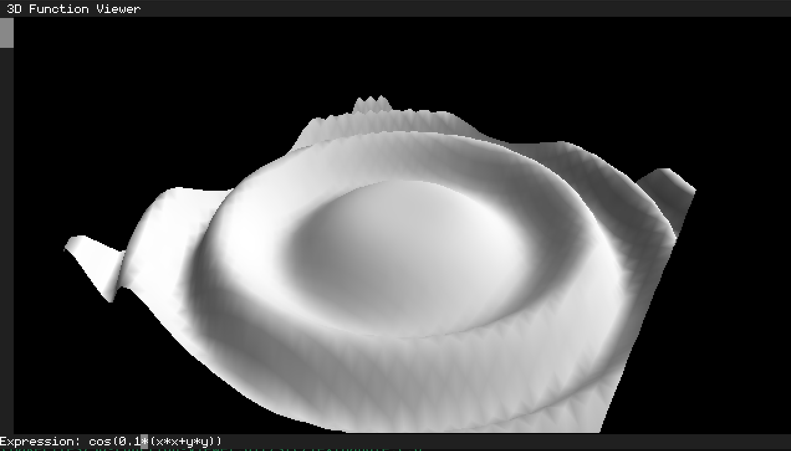

# 3D Function Viewer

**3D Function Viewer** is a program to view functions in 3D. It is written in C99
and distributed under the **GNU GPL Version 3 license**.



This program can be used to view a variety of functions of type `z = f(x,y)`
through many different angles.

**3D Function Viewer** only depends on **SDL3**, CMake, the C standard library
and a few single-header files that are already included in this repository.

# Building

The only external library that the program needs is `libsdl3-dev`, and it also
needs CMake for building. Here are the compilation steps:

```sh
git clone --recursive https://github.com/GabrielMtins/3D-Function-Viewer.git
cd 3D-Function-Viewer
cmake -B build
cmake --build build
```

If you want to compile this application to webassembly, here are the steps:

```
git clone --recursive https://github.com/GabrielMtins/3D-Function-Viewer.git
cd 3D-Function-Viewer
emcmake -B build
cmake --build build
```

# Web demo

You can check a web demo of this application on:
[](https://gabrielmtins.github.io/3D-Function-Viewer/demo/).
